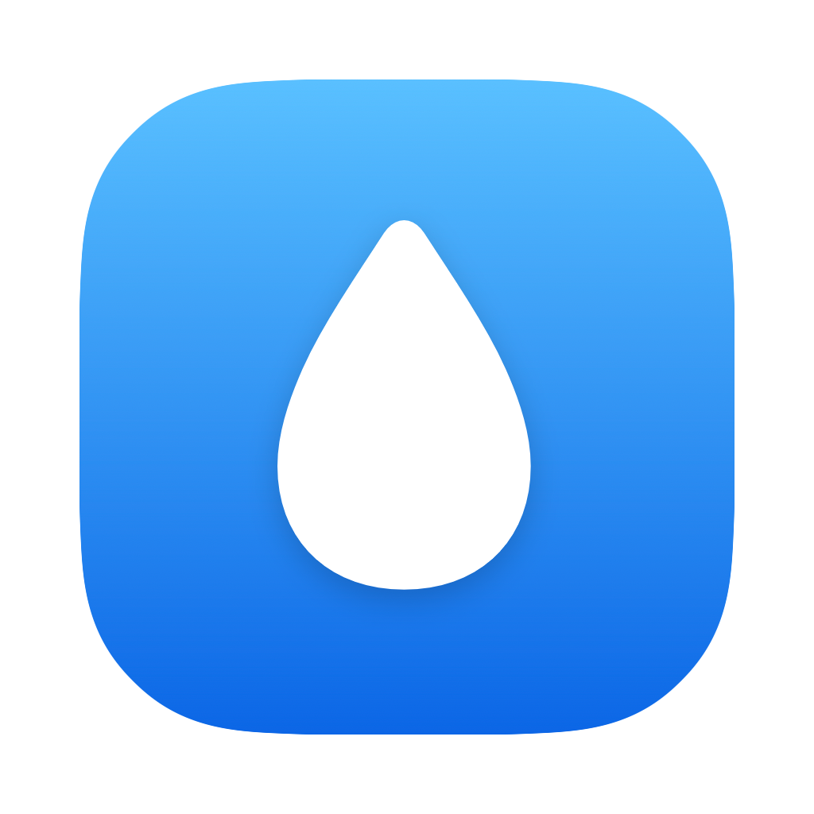

<p align="center"></p>

# 인공눈물 타이머 (TearTime)

맥을 쓰는 동안 인공눈물 넣을 때를 알려 주는 무료 메뉴바 앱입니다.
A free macOS menu bar app that reminds you to use eye drops while you work.

**[다운로드 / Download (TearTime.zip)](https://github.com/d4ymonth/teartime/releases/latest/download/TearTime.zip)**

## 기능
- 맥을 실제로 쓰는 시간만 셉니다. 2분 넘게 입력이 없으면 자리 비움으로 보고 멈춥니다.
- 정한 간격(20~120분)이 차면 화면 위에 알림 창을 띄웁니다. 넣었어요, 10분 뒤, 30분 뒤.
- 하루 상한(기본 6회)에 도달하면 알림을 멈춥니다.
- 깃허브 잔디처럼 최근 20주 점안 기록을 보여 줍니다.
- 한국어, 영어, 일본어, 독일어, 중국어(간체). 맥 언어 설정을 따릅니다.
- 데이터는 내 맥에만 저장되고 어디로도 보내지 않습니다.

## 설치 (macOS 15 이상, 애플실리콘, 인텔 모두)
1. TearTime.zip을 받아 압축을 풀고 `TearTime.app`을 응용 프로그램 폴더로 옮깁니다.
2. 처음 열면 "확인할 수 없음" 경고가 뜹니다. 앱스토어 밖에서 배포하는 무료 앱이라 Apple 공증을 받지 않았기 때문입니다. **완료**를 누르세요.
3. 시스템 설정 > 개인정보 보호 및 보안으로 가서 아래쪽 **그래도 열기**를 누릅니다.

터미널이 편하면 아래 한 줄로도 됩니다.
```
xattr -dr com.apple.quarantine /Applications/TearTime.app
```

## Install (macOS 15+, Apple silicon and Intel)
1. Download TearTime.zip, unzip, and move `TearTime.app` to Applications.
2. On first launch macOS warns that it cannot verify the app (it is not notarized). Click **Done**.
3. Open System Settings > Privacy & Security and click **Open Anyway**.

## 직접 빌드 / Build from source
Xcode 26 이상이 설치된 맥에서:
```
./build.sh
```
`build/TearTime.app`과 `build/TearTime.zip`이 만들어집니다. `TearTime --selftest`로 핵심 로직을 확인할 수 있습니다.

## 피드백 / Feedback
앱 메뉴의 **피드백** 버튼, 또는 [Issues](https://github.com/d4ymonth/teartime/issues).

이 앱은 의료기기가 아니며 진단이나 치료를 대신하지 않습니다. 점안 횟수는 의사, 약사의 안내를 따르세요.
This app is not a medical device. Follow your doctor's or pharmacist's directions.

MIT License
